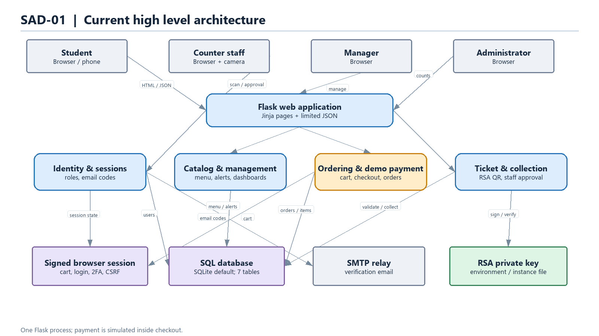
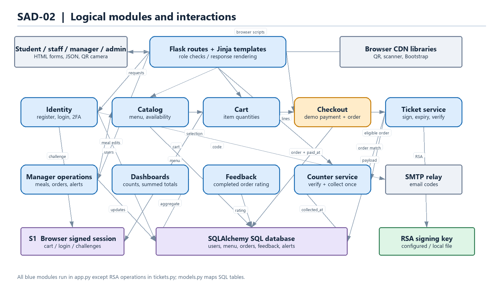
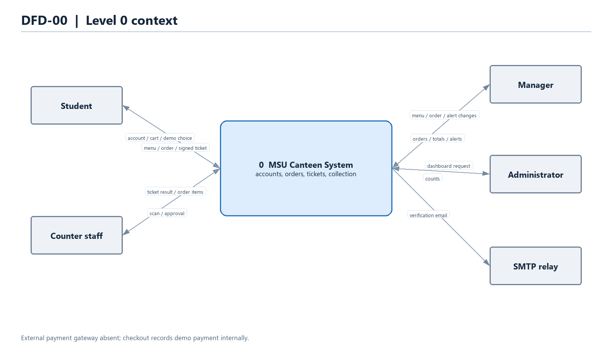
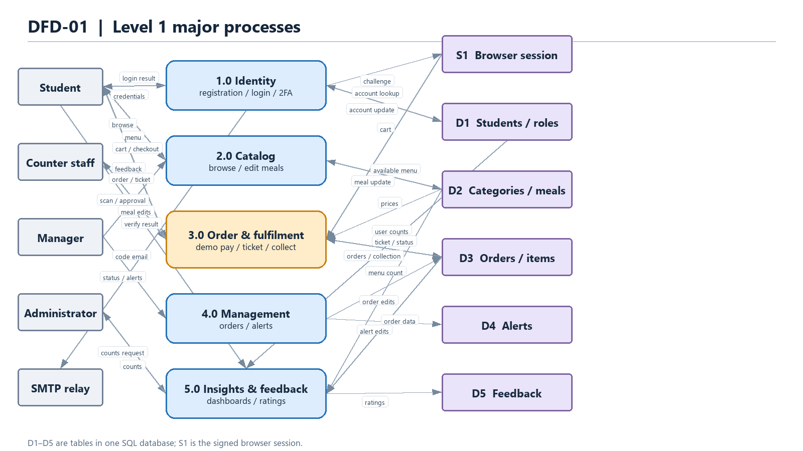
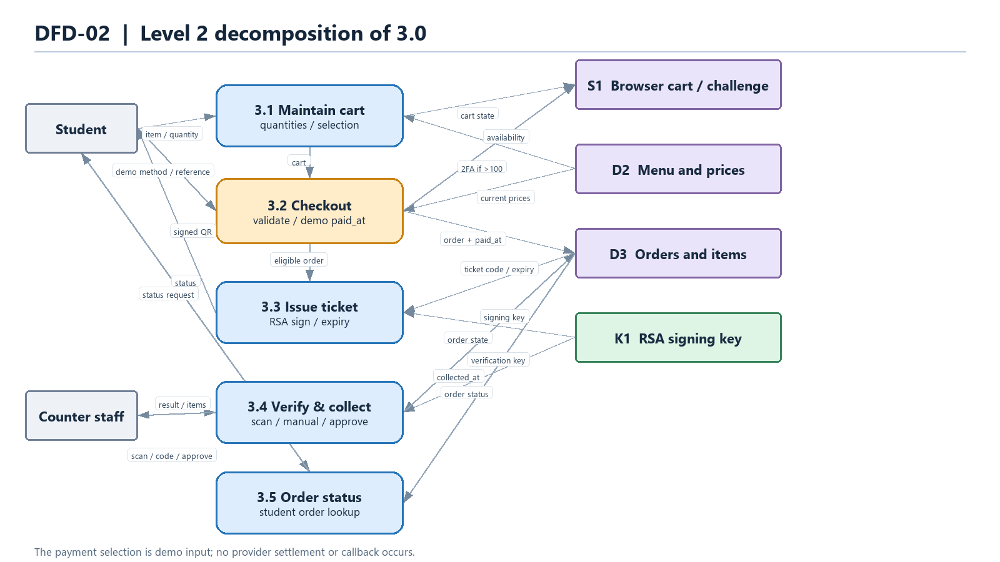
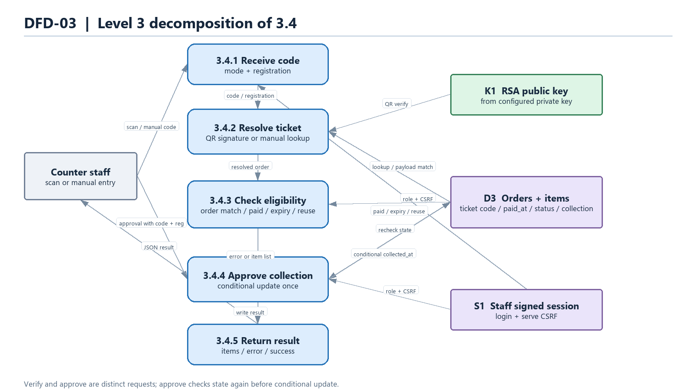

# MSU Canteen System — Preliminary System Specification

**Version:** 0.1 (as-is baseline)  
**Review date:** 30 October 2026  
**Basis:** repository source inspection, not a deployment or security certification.  
**Project:** `secure-msu-canteen-system`

## 1. Project definition and aim

The MSU Canteen System is a web application for students to browse meals, place canteen orders, receive a signed meal ticket, and collect food at a staffed counter. Managers maintain the menu and orders; counter staff verify and redeem tickets; administrators see basic operating counts. The intended outcome is a more orderly, traceable meal purchase and collection process, with role based access and protection against reused or forged QR tickets.

The current repository is a **Flask monolith**, not a set of separately deployed services. This specification describes implemented behaviour first. The production target is discussed as future work and is not shown as present infrastructure.

## 2. Technical scope and current specifications

| Area | Current implementation | Boundary / qualification |
|---|---|---|
| Client | Server rendered Jinja HTML, Bootstrap and JavaScript; browser or phone. QR generation and camera scanning use CDN libraries. | No native mobile app. Public `/api/menu` and `/api/categories` return JSON. |
| Application | Python Flask 3.1.3 application factory in `app.py`; routes and business logic mostly in one module. | Local runner starts Flask development server. No reverse proxy, WAF, Gunicorn, worker, or container configuration is present. |
| Identity | Student registration and password login via Flask-Login; email code for registration, stale login (7 days), and orders over 100. Roles: student, staff, manager, admin. | Staff/manager/admin accounts are created on first login using shared role access keys. Email codes and cart state reside in Flask's signed client session cookie. |
| Catalog | Categories and meals, search/filter, prices, availability, manager add/edit/delete. Images are URL strings. Startup seeding refreshes parts of the menu. | No image storage or inventory/stock reservation. |
| Ordering | Browser session cart, authenticated student checkout, order and line item records, status tracking and manager edits. | Checkout is a **demo payment**: it validates a method and reference length, then records `paid_at` locally. The reference is not persisted; no provider charge or callback is implemented. |
| Ticketing | RSA-PSS/SHA-256 signed QR payload, expiry at local midnight after purchase day, optional one day extension, server record matching. Manual code plus registration lookup also exists. | Ticket issuing depends on the locally recorded `paid_at`, which currently means demo payment. |
| Counter collection | Staff camera/manual verification, payment/expiry/cancellation/collection checks, and conditional database update on approval. | The conditional update prevents a second successful collection of the same order. No offline redemption path. |
| Operations | Manager order status/items/extension, alert CRUD, manager totals; admin counts; staff order list; student feedback after completion. | Alerts appear on the manager management page; no student alert display or alert delivery path was found. No dedicated audit log or formal financial report. |
| Persistence | Flask-SQLAlchemy with SQLite default (`instance/canteen.db`); `DATABASE_URL` can override the URI. Tables: `students`, `categories`, `menu_items`, `orders`, `order_items`, `feedback`, `alerts`. | PostgreSQL is not provisioned or required by dependencies. `db.create_all()` and ad hoc column additions run at startup rather than versioned migrations. |
| Email and secrets | Flask-Mail SMTP, environment configuration, RSA private key from environment or generated local instance file in development. Production mode requires configured Flask secret and ticket key. | Configuration contains fallback credentials/secrets, including an SMTP password. Rotate and remove those values before real deployment. No secret manager is integrated. |

**Data model.** `Student` holds all four roles. A `Category` has `MenuItem` records. An `Order` belongs to a student, contains `OrderItem` snapshots (`quantity`, `unit_price`, `subtotal`), and may have one `Feedback`. `Order` also holds ticket code, payment method, `paid_at`, collection fields, status, and ticket extension days. `Alert` records a manager authored notice. Monetary values use floating point columns.

**Primary state changes.** Checkout creates an order with `pending` status and `paid_at`; managers may set `pending`, `confirmed`, `preparing`, `ready`, `completed`, or `cancelled`; successful counter approval sets `completed`, `collected_at`, and `collected_by_id`. The ticket verification endpoint does not require `ready` status: any otherwise valid, uncollected, non-cancelled, non-completed order can pass.

## 3. System architecture diagrams

**Notation:** Blue = implemented application component or data store; amber = demo or incomplete payment boundary; gray = external actor/service; arrows show actual request or data flow. Logical modules in the detailed view are code responsibilities inside one Flask process, not microservices. The `.drawio` files are editable source diagrams; PNG copies are included for reading and for the Word document.

### 3.1 High level system architecture (SAD-01)

The system has one Flask application serving HTML and limited JSON to four roles. It persists transactional data in SQLite by default, sends verification codes through SMTP when configured, and signs meal tickets with an RSA private key. Browser loaded CDN libraries generate and scan QR codes. The payment block is an internal demo path, with no connection to a payment provider. The sample's edge proxy, PostgreSQL, Redis, image store, SMS, and managed secret store are not implemented here.

### 3.2 Detailed module and interaction architecture (SAD-02)

The detailed diagram follows the registration/login, catalog/cart, checkout, ticket, counter, manager, reporting, and feedback interactions. The session holds login and cart state plus 2FA and route-specific CSRF values. `app.py` implements these logical modules in route handlers and nested helpers; `tickets.py` handles signing and signature verification; `models.py` defines persistence. The only server-side outside service call in the present code is SMTP for verification email.

### 3.3 Implementation completeness and production target

The project is a functional prototype for menu browsing, demo ordering, ticket issue and redemption, and basic role workflows. It does **not** yet establish that a customer paid real funds. A production deployment should first add a payment provider integration with verified, idempotent callbacks and reconciliation; only provider-confirmed transactions should set `paid_at` and unlock ticket issue. It should then remove embedded fallback secrets, replace shared role keys with individually provisioned accounts and stronger staff authentication, move expiring 2FA challenges and rate limits server side, and apply consistent CSRF protection to state changing routes. Versioned migrations, transactional money types, order/payment audit events, automated tests, backups, monitoring, and a documented HTTPS deployment topology are also needed. PostgreSQL, Redis, a reverse proxy, SMS, image storage, and a secret manager are possible deployment choices, not current components or mandatory architecture choices.

## 4. Data flow diagrams (DFD)

**Notation:** Gray rectangle = external entity; rounded blue or amber rectangle = process; purple rectangle = logical data store; labelled arrow = data flow. DFDs describe data movement, not network deployment. `S1` is a logical representation of the Flask signed browser session, whereas `D1`–`D5` are tables in the same configured SQL database. The SMTP relay is an external entity only for email code delivery. No payment provider is included because none is called.

### 4.1 Level 0 — context (DFD-00)

One system process exchanges account, menu, order, ticket, collection, management, and reporting data with students, counter staff, managers, administrators, and the SMTP relay. The demo payment choice is an input from the student, not evidence of external settlement.

### 4.2 Level 1 — system processes (DFD-01)

`1.0` handles identity and email challenge; `2.0` handles menu; `3.0` handles order, demo payment, ticket, and collection; `4.0` handles management and alerts; `5.0` handles dashboards and feedback. The store boundaries correspond to the model tables and browser session.

### 4.3 Level 2 — process 3.0 decomposition (DFD-02)

`3.1` manages the cart; `3.2` validates checkout and records the demo payment; `3.3` creates a signed ticket from an eligible order; `3.4` verifies and collects a ticket; `3.5` returns order status. Manager status and ticket-extension changes belong to process `4.0` and affect the shared order store. Feedback belongs to process `5.0`. This diagram balances the student and staff flows of `3.0` in Level 1.

### 4.4 Level 3 — process 3.4 decomposition (DFD-03)

`3.4.1` accepts a scan or manual code; `3.4.2` validates a QR signature and payload or performs manual lookup; `3.4.3` checks server state, registration, payment marker, expiry, and reuse; `3.4.4` conditionally writes collection data; `3.4.5` returns the result to staff. Signed QR is checked against the RSA public key derived from the configured private key and against the order row. The approval request uses code and registration to recheck state immediately before updating it.

## 5. Requirements and design decisions to settle before production

| Priority | Decision / requirement | Reason from current implementation |
|---|---|---|
| Critical | Define real payment provider(s), confirmation state, webhook signature verification, idempotency, failed/refunded payments, and reconciliation. | Demo checkout marks an order paid without transferring funds; editing paid order items changes totals without a payment adjustment. |
| Critical | Remove exposed fallback mail credential and all default role/secret keys; rotate affected credentials and provision staff accounts individually. | `config.py` contains defaults, and a role key creates new privileged accounts. |
| High | Specify whether collection requires `ready`, and formalize legal order state transitions. | Current ticket checks allow collection before `ready`; manager status changes are broad. |
| High | Store short-lived, attempt-limited verification challenges server side; add rate limits and consistent CSRF coverage. | 2FA and cart live in a signed browser cookie; only selected endpoints have explicit CSRF tokens. |
| High | Define database, migrations, transactional guarantees, retention, backup/restore, and money precision. | SQLite default, startup schema sync, and floating point amounts are suitable mainly for prototype use. |
| Medium | Decide whether alerts must reach students, whether SMS is needed, and which reports/audit events are required. | Alert CRUD is manager facing; dashboard counts are limited. |
| Medium | Define deployment topology and operational targets (TLS, uptime, logging, monitoring, capacity). | No production server or infrastructure manifests are in the repository. |

## 6. Source traceability and limitations

| Claim | Source |
|---|---|
| Application factory, startup schema/seed, login manager | `app.py` lines 35–78 |
| Identity and email verification | `app.py` lines 191–238, 286–525 |
| Ticket verify/collect | `app.py` lines 578–661; `tickets.py` lines 16–72 |
| Menu and manager operations | `app.py` lines 663–1066 |
| Cart, checkout, order, feedback, APIs | `app.py` lines 1073–1277; `templates/checkout.html` |
| Database entities | `models.py` |
| Configured dependencies and deployment defaults | `requirements.txt`, `config.py`, `run-app.bat` |

This is a source based specification. Runtime behavior, payment security, performance, and production infrastructure were not independently validated. The existing SQLite database has local changes and was not modified for this documentation.
