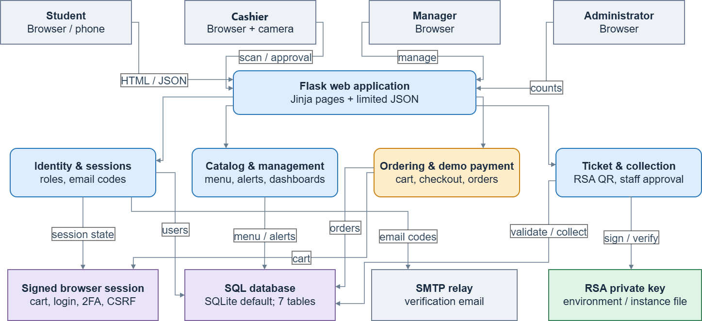
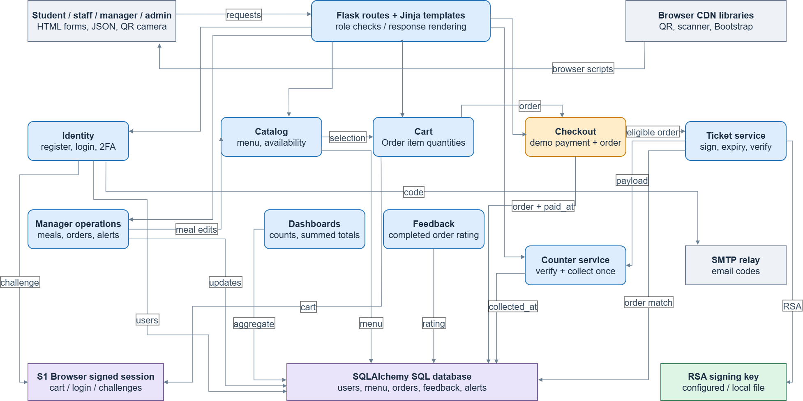
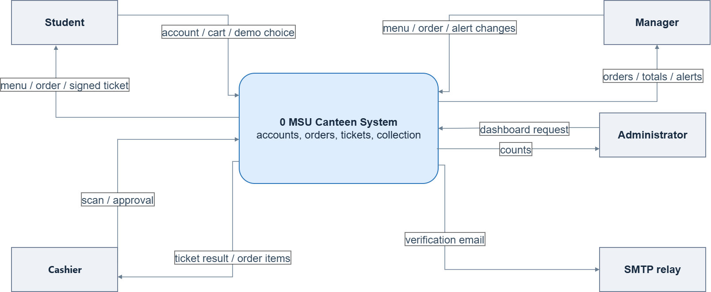
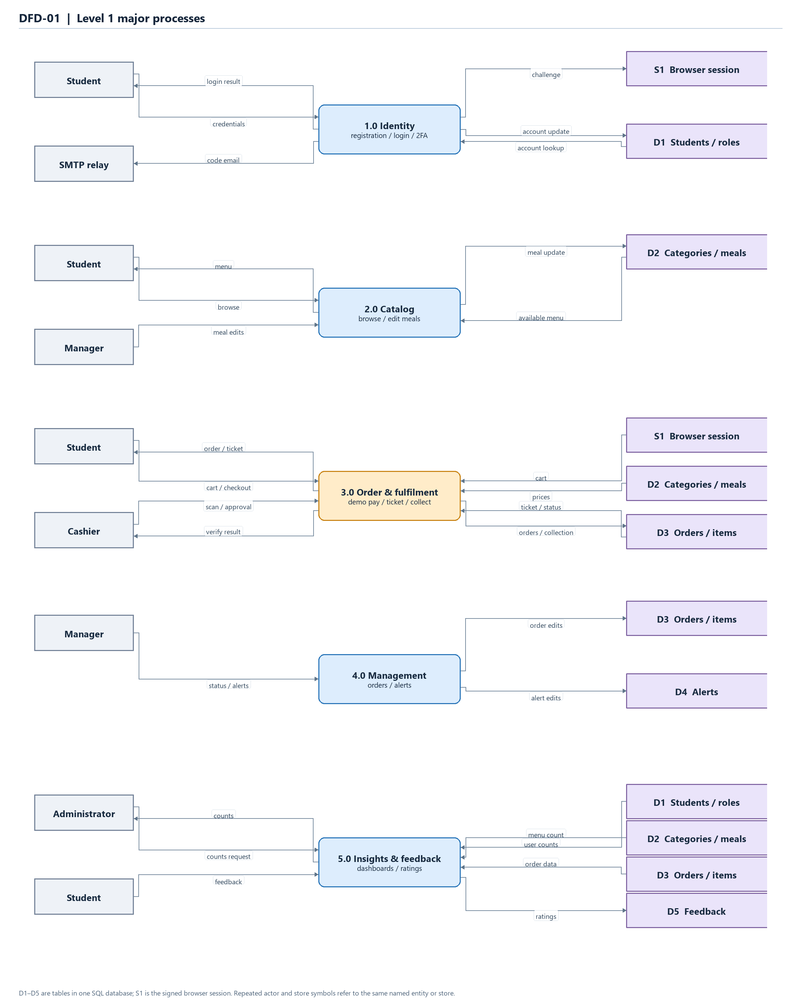
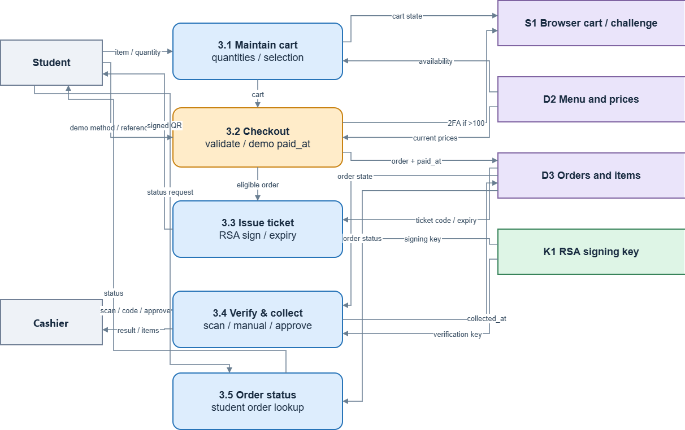
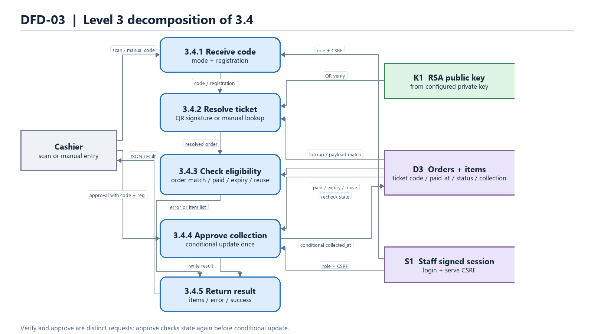
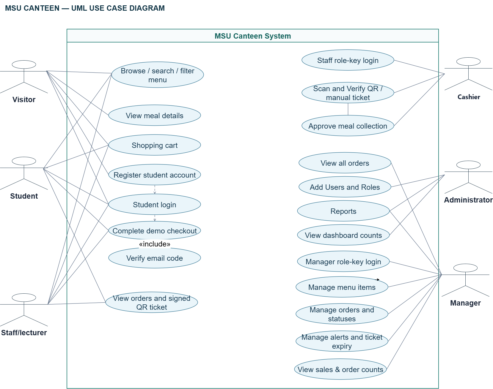

# MSU Canteen System — Preliminary System Specification

**Version:** 0.2 (lecturer feedback revision)  
**Review date:** 17 November 2026  
**Basis:** repository source inspection, not a deployment or security certification.  
**Project:** `secure-msu-canteen-system`

## 1. Project definition and aim

The MSU Canteen System is a web application for students to browse meals, place canteen orders, receive a signed meal ticket, and collect food at a staffed counter. Managers maintain the menu and orders; cashiers verify and redeem tickets; administrators see basic operating counts. The intended outcome is a more orderly, traceable meal purchase and collection process, with role based access and protection against reused or forged QR tickets.

The current repository is a **Flask prototype** implemented as one application, not a set of separately deployed services. The IT Director has expressed a preference for Laravel/PHP; the production stack remains a decision for the Director. This specification describes the existing Flask implementation so that it can be reviewed independently of that decision. If no production stack is selected, Flask remains the prototype baseline.

## 2. Technical scope and current specifications

| Technology | Description |
|---|---|
| Python 3 / Flask 3.1.3 | Prototype server and route handling in `app.py`; one Flask application process. |
| Jinja, HTML, CSS, JavaScript, Bootstrap 5.3.0 | Server-rendered browser interface. The public menu and category endpoints also return JSON. No native mobile application is present. |
| Flask-Login 0.6.3 | Local account sessions and role checks for student, cashier (stored as the `staff` role), manager, and admin accounts. Student login uses email or student ID plus password; privileged roles use shared role access keys. |
| Flask-Mail 0.10.0 / Gmail SMTP | Delivers email verification codes for registration, stale login (7 days), and orders over 100 when mail is configured. Gmail SMTP is a mail delivery service here; it is not Google Sign-In or the system's password authentication provider. |
| Flask-SQLAlchemy 3.1.1 / SQLite | Persists students, categories, menu items, orders, order items, feedback, and alerts. SQLite is the default (`instance/canteen.db`); `DATABASE_URL` can override it. |
| Python `cryptography` / RSA-PSS-SHA-256 | Signs meal-ticket QR payloads and verifies signatures. The ticket expires at local midnight after purchase day and can be extended by one day. |
| QRCode.js 1.0.0 / html5-qrcode 2.3.8 | Browser-side QR generation and camera scanning, loaded from CDNs. Manual code plus registration lookup is also available. |
| Browser session | Holds the cart and short-lived verification state. It is signed by Flask; it is not a separate server-side session store. |
| Flask development server | Used by the local runner. No reverse proxy, WAF, Gunicorn, worker, or container configuration is present. |
| Prototype checkout logic | Validates a selected method and reference length, then records `paid_at` locally. The reference is not persisted; no provider charge or callback is implemented. |

The IT Director's Laravel/PHP preference is a production-stack decision. The technologies above describe the current Flask prototype; they do not commit the production system to Flask. PostgreSQL, Redis, a reverse proxy, image storage, SMS, and a managed secret store are not implemented or required by the prototype.

**Data model.** `Student` holds all four roles. A `Category` has `MenuItem` records. An `Order` belongs to a student, contains `OrderItem` snapshots (`quantity`, `unit_price`, `subtotal`), and may have one `Feedback`. `Order` also holds ticket code, payment method, `paid_at`, collection fields, status, and ticket extension days. `Alert` records a manager authored notice. Monetary values use floating point columns.

**Primary state changes.** Checkout creates an order with `pending` status and `paid_at`; managers may set `pending`, `confirmed`, `preparing`, `ready`, `completed`, or `cancelled`; successful counter approval sets `completed`, `collected_at`, and `collected_by_id`. The ticket verification endpoint does not require `ready` status: any otherwise valid, uncollected, non-cancelled, non-completed order can pass.

## 3. System architecture diagrams

**Notation:** Blue = implemented application component; purple = data store; amber = demo or incomplete payment boundary; gray = external actor/service; arrows show actual request or data flow. Connectors use horizontal and vertical segments with right-angle bends. The detailed view is a proposed package grouping of code responsibilities for the current one-process Flask prototype; it does not claim that these packages already exist as separate folders. The `.drawio` files are editable source diagrams; PNG copies are included for reading and for the Word document.

### 3.1 High level system architecture (SAD-01)

The system has one Flask application serving HTML and limited JSON to four roles. It persists transactional data in SQLite by default, sends verification codes through SMTP when configured, and signs meal tickets with an RSA private key. Browser loaded CDN libraries generate and scan QR codes. The payment block is an internal demo path, with no connection to a payment provider. The sample's edge proxy, PostgreSQL, Redis, image store, SMS, and managed secret store are not implemented here.

### 3.2 Logical package architecture (SAD-02)

The package view names the technologies used by each responsibility and avoids repeating external communication flows or database connections. In the present code, most route responsibilities remain in `app.py`; `tickets.py` handles signing and signature verification, and `models.py` defines persistence. Flask-Mail sends email codes through configured Gmail SMTP.

### 3.3 Implementation completeness and production target

The project is a functional prototype for menu browsing, demo ordering, ticket issue and redemption, and basic role workflows. It does **not** yet establish that a customer paid real funds. A production deployment should first add a payment provider integration with verified, idempotent callbacks and reconciliation; only provider-confirmed transactions should set `paid_at` and unlock ticket issue. It should then remove embedded fallback secrets, replace shared role keys with individually provisioned accounts and stronger staff authentication, move expiring 2FA challenges and rate limits server side, and apply consistent CSRF protection to state changing routes. Versioned migrations, transactional money types, order/payment audit events, automated tests, backups, monitoring, and a documented HTTPS deployment topology are also needed. PostgreSQL, Redis, a reverse proxy, SMS, image storage, and a secret manager are possible deployment choices, not current components or mandatory architecture choices.

## 4. Data flow diagrams (DFD)

**Notation:** These DFDs use Gane–Sarson symbols: gray rectangle = external entity; rounded blue or amber rectangle = numbered process; open-sided purple or green rectangle = logical data store; labelled arrow = directed data flow. All connectors run horizontally or vertically. DFDs describe data movement, not network deployment. `S1` is a logical representation of the Flask signed browser session, whereas `D1`–`D5` are tables in the same configured SQL database; `K1` represents key material. The SMTP relay is an external entity only for email code delivery. No payment provider is included because none is called. Notation references: IBM, *What Is a Data Flow Diagram (DFD)?* (https://www.ibm.com/think/topics/data-flow-diagram); draw.io, *Data flow diagrams (DFDs)* (https://www.drawio.com/docs/diagram-types/data-flow-diagrams/); draw.io, *Style reference for AI diagram generation* (https://www.drawio.com/docs/reference/diagram-generation/style-reference/).

### 4.1 Level 0 — context (DFD-00)

One system process exchanges account, menu, order, ticket, collection, management, and reporting data with students, cashiers, managers, administrators, and the SMTP relay. The demo payment choice is an input from the student, not evidence of external settlement.

### 4.2 Level 1 — system processes (DFD-01)

`1.0` handles identity and email challenge; `2.0` handles menu; `3.0` handles order, demo payment, ticket, and collection; `4.0` handles management and alerts; `5.0` handles dashboards and feedback. The store boundaries correspond to the model tables and browser session.

### 4.3 Level 2 — process 3.0 decomposition (DFD-02)

`3.1` manages the cart; `3.2` validates checkout and records the demo payment; `3.3` creates a signed ticket from an eligible order; `3.4` verifies and collects a ticket; `3.5` returns order status. Manager status and ticket-extension changes belong to process `4.0` and affect the shared order store. Feedback belongs to process `5.0`. This diagram balances the student and staff flows of `3.0` in Level 1.

### 4.4 Level 3 — process 3.4 decomposition (DFD-03)

`3.4.1` accepts a scan or manual code; `3.4.2` validates a QR signature and payload or performs manual lookup; `3.4.3` checks server state, registration, payment marker, expiry, and reuse; `3.4.4` conditionally writes collection data; `3.4.5` returns the result to staff. Signed QR is checked against the RSA public key derived from the configured private key and against the order row. The approval request uses code and registration to recheck state immediately before updating it.

### 4.5 UML use case diagram

The diagram distinguishes visitor, student, cashier, manager, and administrator use cases. Students manage a cart and submit orders through demo checkout; cashiers view orders and verify or redeem tickets, and do not submit food orders through the prototype. Managers maintain menu items, orders, alerts, and ticket expiry. The diagram shows implemented flows; it does not imply real payment settlement.

## 5. Testing and verification status

No automated application test suite or recorded end-to-end workflow test was found in the repository during this documentation review. `test_email_config.py` is a configuration diagnostic that prints mail settings; it is not a functional test of registration, email delivery, authentication, checkout, or ticket collection. No application workflow tests were run for this revision. The specification claims above were checked against source files and editable diagrams only; runtime behaviour was not verified.

The following tests are requirements for acceptance of a production implementation. They have **not** been completed by this documentation revision.

| Area | Required verification |
|---|---|
| Student identity | Register with valid and invalid data; verify email code; check password login by email and student ID; exercise stale-login and incorrect/expired code cases. |
| Role access | Confirm student, cashier, manager, and administrator can access only their authorized pages and actions; confirm cashier cannot submit checkout. |
| Menu and cart | Browse and filter meals; add, update, remove, and clear cart items; reject unavailable items and invalid quantities. |
| Checkout | Submit valid and invalid checkout data; confirm only students can order; exercise the over-100 email-code challenge; verify that current demo checkout is not treated as real external settlement. |
| Ticketing and collection | Verify valid and tampered QR payloads, manual code lookup, expiry, cancellation, unpaid and already-collected orders; confirm two concurrent approvals cannot collect the same order twice. |
| Management and reporting | Check manager menu/order/alert actions and role restrictions; compare displayed counts and totals with stored records. |
| Persistence and operations | Check database initialization and migration path, backup/restore, error handling, and deployment configuration before production. |

## 6. Requirements and design decisions to settle before production

| Priority | Decision / requirement | Reason from current implementation |
|---|---|---|
| Critical | Define real payment provider(s), confirmation state, webhook signature verification, idempotency, failed/refunded payments, and reconciliation. | Demo checkout marks an order paid without transferring funds; editing paid order items changes totals without a payment adjustment. |
| Critical | Remove exposed fallback mail credential and all default role/secret keys; rotate affected credentials and provision staff accounts individually. | `config.py` contains defaults, and a role key creates new privileged accounts. |
| High | Specify whether collection requires `ready`, and formalize legal order state transitions. | Current ticket checks allow collection before `ready`; manager status changes are broad. |
| High | Store short-lived, attempt-limited verification challenges server side; add rate limits and consistent CSRF coverage. | 2FA and cart live in a signed browser cookie; only selected endpoints have explicit CSRF tokens. |
| High | Define database, migrations, transactional guarantees, retention, backup/restore, and money precision. | SQLite default, startup schema sync, and floating point amounts are suitable mainly for prototype use. |
| Medium | Decide whether alerts must reach students, whether SMS is needed, and which reports/audit events are required. | Alert CRUD is manager facing; dashboard counts are limited. |
| Medium | Define deployment topology and operational targets (TLS, uptime, logging, monitoring, capacity). | No production server or infrastructure manifests are in the repository. |

## 7. Source traceability and limitations

| Claim | Source |
|---|---|
| Application factory, startup schema/seed, login manager | `app.py` lines 35–78 |
| Identity and email verification | `app.py` lines 191–238, 286–525 |
| Ticket verify/collect | `app.py` lines 578–661; `tickets.py` lines 16–72 |
| Menu and manager operations | `app.py` lines 663–1066 |
| Cart, checkout, order, feedback, APIs | `app.py` lines 1073–1277; `templates/checkout.html` |
| Database entities | `models.py` |
| Configured dependencies and deployment defaults | `requirements.txt`, `config.py`, `run-app.bat` |

This is a source based specification. Runtime behavior, payment security, performance, and production infrastructure were not independently validated. The existing SQLite database has local changes and was not modified for this documentation.

## Appendix A. Lecturer comments and completion marks

The comments below are retained from the supplied document. A checked box means the documentation or diagram change is complete and supported by the current repository. Unchecked comments remain open or need a decision beyond this documentation change.

- [x] `//##Include your technology stack`
- [x] `//##Have  a column for technologies and the other for description, don't mix those`
- [x] `//##Modules will be packages`
- [x] `//##Put a class diagram or a package diagram`
- [x] `//##There wont be need to show connections with the database`
- [x] `//##Dont redefine how you communicate with their system since you will have defined that already`
- [x] `//##Fnd the correct name for counter staff (Must be cashier)`
- [x] `//##Some of the arrows are not necessary eg student adding to cart, they can only be there then the students are receiving something in turn`
- [x] `//##IT director prefers Laravel PHP`
- [x] `//##Specfy that we have a Flask Prototype then he can choose the tech stack if he wants but incase he does not have then you ca use Flask`
- [x] `//##You need to know all items you put in the architecture diagram must have a technology`
- [ ] `//##Use technology that` - unfinished comment; no technology choice can be inferred from this fragment.
- [x] `//## Use The Gmail service for authentication` - documented as Gmail SMTP delivery for verification codes, not Google Sign-In; user authentication remains local to the prototype.
- [x] `//##Take into consideration the ordering of food (Difference between the student and a staff member)`
- [x] `//##Add a use case diagram`
- [x] `//##Testing requirements are needed - what test you did for that thing to work out` - requirements and actual verification status are stated separately; no workflow tests are claimed.
